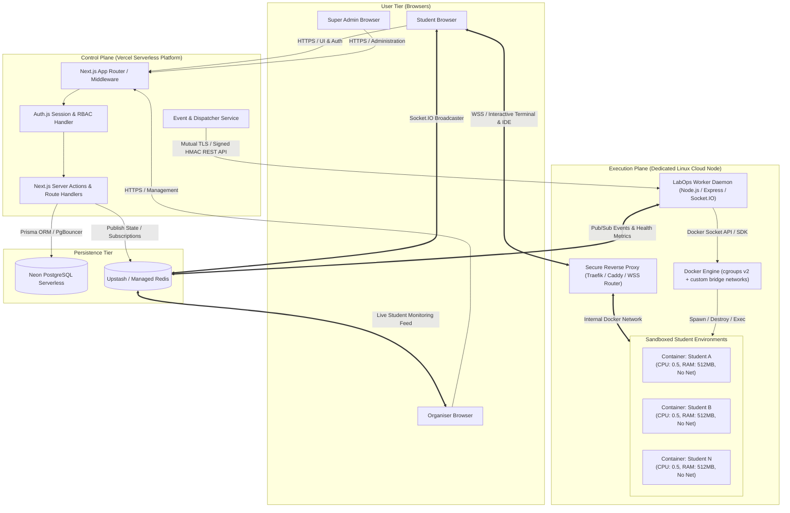
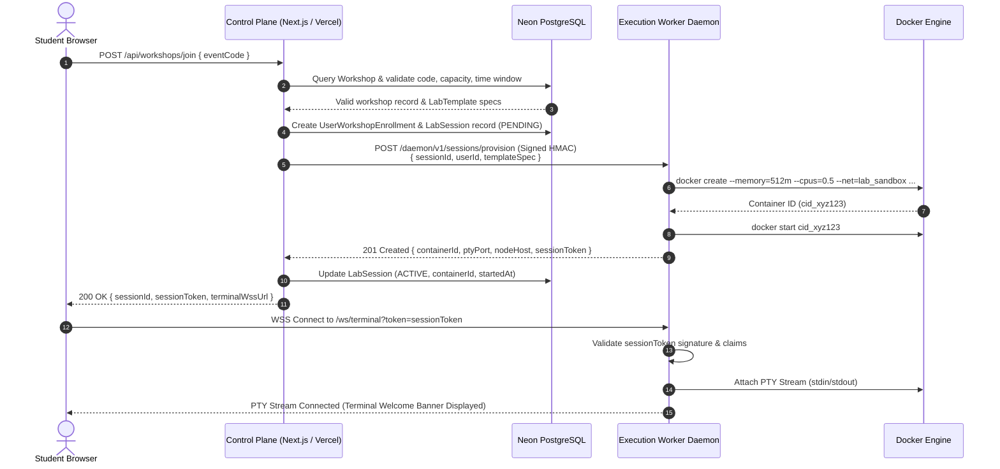
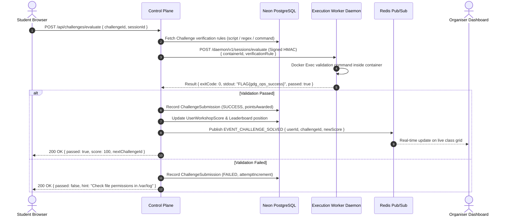
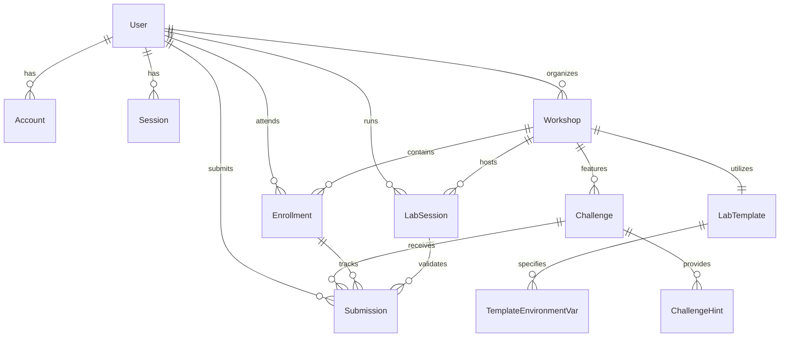
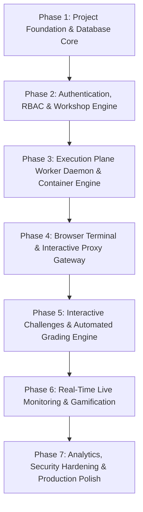

# GDG LabOps – Technical Workshop Infrastructure Platform
## System Architecture & Technical Specifications Document (ARCHITECTURE.md)

**Version:** 1.0.0-PROD-PLAN  
**Target Environment:** GDG on Campus (Google Developer Groups on Campus)  
**Author / Architect:** AI System Architect & Senior Platform Engineer  
**Status:** Pending Approval  

---

## 1. Executive Summary & Purpose

**GDG LabOps** is a production-grade, multi-tenant workshop infrastructure and hands-on laboratory platform designed for Google Developer Groups (GDG) on Campus. 

### The Problem
Traditional technical workshops (Cloud, DevOps, Web Development, Cybersecurity, AI/ML) face high friction:
- **Setup Fatigue:** 30–60 minutes lost per workshop troubleshooting local OS, package manager, and dependency issues across Windows, macOS, and Linux.
- **Hardware Disparity:** Inconsistent RAM, CPU, or missing virtualization capabilities (e.g., Docker Desktop issues on student machines).
- **Security Risks in Cyber Labs:** Running vulnerable targets, exploit scripts, or network scans locally on university campus networks can violate IT policies or compromise student machines.
- **Zero Visibility:** Organizers cannot observe which students are stuck, how far they have progressed, or who completed specific challenges.

### The Solution
GDG LabOps abstracts local environments into **isolated, browser-accessible Docker containers** with real-time web terminals/IDEs, automated evaluation bots, live progress dashboards for organizers, and gamified leaderboards for students.

---

## 2. Technology Stack & Technical Justifications

| Layer | Selected Technology | Technical Justification |
| :--- | :--- | :--- |
| **Frontend Framework** | **Next.js 14+ (App Router, React Server Components)** | High-performance hybrid rendering (SSR for dynamic dashboards, RSC for reduced client-side JavaScript bundle, streaming UI with Suspense for instant page transitions). Native integration with Vercel edge runtime and API route handlers. |
| **Language** | **TypeScript (Strict Mode)** | End-to-end type safety spanning database models (Prisma), API payloads, WebSocket events, and container execution schemas, eliminating runtime type mismatches. |
| **Styling & Design System** | **Tailwind CSS + Radix UI (shadcn/ui)** | Utility-first CSS providing minimal bundle overhead, deterministic styling, robust accessible primitives (modals, dropdowns, tabs), and responsive developer-centric UI theme consistent with Google Material/GDG guidelines. |
| **Database** | **Neon PostgreSQL (Serverless)** | Cloud-native Postgres with connection pooling (PgBouncer), automatic compute scaling, instant branching for isolated staging/testing environments, and low-latency read/write access. |
| **ORM** | **Prisma ORM** | Type-safe query generation, automated migration workflows, declarative schema definition, and seamless relation handling with high maintainability. |
| **Authentication** | **Auth.js (NextAuth.js v5)** | Stateless JWT session support with OAuth 2.0 (Google OAuth for GDG students/organizers, GitHub OAuth for developer personas) and credentials-based access for local/offline testing. Native Next.js middleware protection. |
| **Execution Sandboxing** | **Docker Engine (Containerd)** | Industry-standard, lightweight virtualization. Allows sub-second startup times using pre-warmed image layers, strict cgroup/namespace resource limits, and network bridge isolation. |
| **Real-time Engine** | **Socket.IO + Redis Pub/Sub** | Bi-directional, event-driven state sync for live monitoring, instantaneous challenge grade broadcast, container health heartbeats, and live leaderboard updates across distributed workers. |
| **Control Plane Host** | **Vercel** | Global edge distribution, automated CI/CD previews, zero-downtime deployments, and managed serverless API routes for all user-facing interactions. |
| **Execution Plane Host** | **Dedicated Cloud Linux Host (Ubuntu 24.04 LTS)** | Unrestricted kernel capabilities required for Docker socket operations (`/var/run/docker.sock`), custom network bridges, iptables egress controls, and stateful WebSockets for interactive terminals without serverless timeout constraints. |

---

## 3. Requirements Analysis

### 3.1 Functional Requirements (FR)

- **FR-01: Workshop Lifecycle Management:** Organizers can create, edit, schedule, publish, pause, and archive workshops with rich metadata (prerequisites, track, difficulty, duration).
- **FR-02: Secure Access via Event Codes:** Dynamic alphanumeric code generation (e.g., `GDG-K8S-2026`) with expiration timestamps, capacity quotas, and optional domain-whitelisting (e.g., `@university.edu`).
- **FR-03: Reusable Lab Template Catalog:** Declarative templates defining Docker images, default ports, environment variables, resource constraints (CPU/RAM limits), pre-seeded challenge files, and terminal welcome banners.
- **FR-04: In-Browser Lab Access:** Zero-install interactive terminals (via `xterm.js` and PTY over WebSocket) or embedded lightweight VS Code environments (`code-server`) rendered directly within the browser interface.
- **FR-05: Interactive Multi-Step Challenges:** Workshops feature progressive milestones with clear problem statements, hints (with optional point penalties), and verification specifications.
- **FR-06: Automated Task Evaluation:** Non-intrusive container grading using exit-code assertions, stdout pattern matching, file-content checks, or HTTP endpoint verification executed directly inside the user's isolated container.
- **FR-07: Real-Time Organizer Observability:** Live dashboard displaying connected students, active container statuses (Running, Idle, Error, Terminated), current challenge index, and task completion rates.
- **FR-08: Gamified Leaderboards & Achievements:** Real-time scoring based on completion timestamps, hint penalties, and streak bonuses, accompanied by digital milestone badges.
- **FR-09: Workshop Post-Mortem & Reporting:** Exportable performance metrics (completion rates, bottleneck challenges, drop-off rates, time-per-task) in CSV/PDF format.

### 3.2 Non-Functional Requirements (NFR)

- **NFR-01: Security & Sandboxing (Highest Priority):** Containers must run with unprivileged user permissions (`non-root`), disabled privileged flags, dropped Linux capabilities (e.g., `CAP_SYS_ADMIN`), read-only root filesystems where applicable, and no access to the host Docker daemon or metadata services.
- **NFR-02: Scalability & Concurrency:** The architecture must effortlessly support **100+ concurrent active lab containers** per standard cloud worker instance with predictable RAM/CPU isolation.
- **NFR-03: Low Latency:** Web terminal keystroke round-trip latency must remain under **100ms** on typical broadband connections.
- **NFR-04: Fault Isolation:** Failure or crash of a student's container (e.g., fork bomb or memory exhaustion) must never impact the host server or neighboring student containers.
- **NFR-05: Ephemerality & Lifecycle Cleanup:** Automatic garbage collection of orphaned or idle containers (configurable inactivity timeout, e.g., 20 minutes) to prevent resource leakage.
- **NFR-06: Auditability & Observability:** Structured JSON logging for all authentication attempts, container lifecycle events, and task validation results.

### 3.3 Cross-Platform & Device Compatibility Requirements

- **Operating-System Independence:** The platform frontend runs entirely in standards-compliant web browsers without requiring local package managers, virtualization, or Docker installations on student hardware.
- **Certified Operating Systems:**
  - **Desktop / Laptop:** Windows 10 & 11, macOS (Intel & Apple Silicon), Linux (Ubuntu, Debian, Fedora, Arch, etc.), ChromeOS.
  - **Mobile / Tablet:** Android (v10+), iOS & iPadOS (v15+).
- **Certified Browser Engines:**
  - Google Chrome (Blink v110+)
  - Microsoft Edge (Blink v110+)
  - Mozilla Firefox (Gecko v115+ ESR)
  - Apple Safari (WebKit v16+)
- **Adaptive Breakpoint Matrix:**
  - Mobile Phones (`< 640px`): Single-column, collapsible sidebar, segmented guide/terminal tabs, virtual keyboard accessory keys.
  - Tablets (`640px - 1024px`): Responsive grids, fluid tables, touch-optimized button targets (`min 40px`).
  - Laptops (`1024px - 1440px`): Dual-column split IDE / guide layout, fixed sidebar, live telemetry charts.
  - Large Desktop Displays (`> 1440px`): High-density live monitoring grid, multi-pane terminal views.
- **Remote Cloud Execution Invariant:** Docker containers execute exclusively on dedicated Linux worker hosts in isolated network bridges. Zero container execution occurs on student devices.
- **Device Ergonomics Transparency:** Terminal-heavy workshops display clear advisories recommending a physical keyboard and laptop/desktop screen, while maintaining mobile capability for reading curriculum, reviewing hints, and viewing live chapter leaderboards.

---

## 4. System Architecture: Control Plane vs. Execution Plane

To guarantee security, scalability, and adherence to platform constraints (such as Vercel's serverless execution limits), the system strictly decouples the **Control Plane** from the **Execution Plane**.



### 4.1 Architectural Plane Responsibilities

#### Control Plane (Vercel)
- Hosts the responsive Next.js application, user dashboards, and authentication logic.
- Maintains single-source-of-truth business state in Neon PostgreSQL.
- Verifies permissions, workshop schedules, and registration codes.
- Issues short-lived, cryptographically signed JSON Web Tokens (`SessionJWT`) authorizing terminal access on the Execution Plane.
- Emits container lifecycle requests (Provision, Terminate, Reset, Evaluate) to the Worker Daemon via signed webhook payloads.

#### Execution Plane (Dedicated Cloud Host)
- Runs a hardened Linux operating system (Ubuntu Server) with Docker Engine and a lightweight **LabOps Worker Daemon**.
- Listens strictly for authenticated commands from the Control Plane using a shared secret / HMAC signature.
- Manages local container lifecycles: pulls cached workshop images, applies strict cgroups, and mounts ephemeral volumes.
- Provides a WebSocket Gateway (`xterm-pty-proxy`) that authenticates student `SessionJWT` tokens and attaches client connections directly to the container's pseudo-terminal (PTY) without routing heavy terminal byte-streams through Vercel.
- Executes automated task validation commands directly inside targeted containers and dispatches results back to Redis/Postgres.

---

## 5. Detailed Component Workflows

### 5.1 Workshop Join & Container Provisioning Sequence



### 5.2 Automated Challenge Evaluation Sequence



---

## 6. User Roles and Permissions Matrix (RBAC)

The platform implements a strict Role-Based Access Control (RBAC) model across four primary actor roles:

| Module / Operation | Anonymous | Student | Organiser | Super Admin |
| :--- | :---: | :---: | :---: | :---: |
| **View Public Workshop Catalog** | ✅ | ✅ | ✅ | ✅ |
| **Join Workshop via Event Code** | ❌ | ✅ | ✅ | ✅ |
| **Launch / Reset Own Lab Container** | ❌ | ✅ | ✅ | ✅ |
| **Submit Challenge for Auto-Grading** | ❌ | ✅ | ✅ | ✅ |
| **View Personal Progress & Leaderboard** | ❌ | ✅ | ✅ | ✅ |
| **Create & Edit Workshops** | ❌ | ❌ | ✅ | ✅ |
| **Publish / Archive Workshops** | ❌ | ❌ | ✅ | ✅ |
| **Manage Lab Templates (Images, Resources)**| ❌ | ❌ | ✅ | ✅ |
| **Live Student Monitor (Grid / Kill Container)**| ❌ | ❌ | ✅ | ✅ |
| **Export Workshop Analytics & CSVs** | ❌ | ❌ | ✅ | ✅ |
| **Promote User to Organiser** | ❌ | ❌ | ❌ | ✅ |
| **Global Platform & Worker Node Config** | ❌ | ❌ | ❌ | ✅ |
| **Audit Log Inspection** | ❌ | ❌ | ❌ | ✅ |

---

## 7. Database Entities and Relational Schema (Prisma)

### 7.1 Entity Relationship Diagram



### 7.2 Complete Prisma Schema Definition

```prisma
datasource db {
  provider = "postgresql"
  url      = env("DATABASE_URL")
}

generator client {
  provider = "prisma-client-js"
}

enum Role {
  STUDENT
  ORGANISER
  SUPER_ADMIN
}

enum WorkshopStatus {
  DRAFT
  PUBLISHED
  ACTIVE
  PAUSED
  COMPLETED
  ARCHIVED
}

enum SessionStatus {
  INITIALIZING
  RUNNING
  IDLE
  STOPPED
  TERMINATED
  ERROR
}

enum EvaluationType {
  COMMAND_EXIT_CODE
  STDOUT_REGEX
  FILE_CONTENT
  HTTP_PROBE
}

model User {
  id            String       @id @default(cuid())
  name          String?
  email         String       @unique
  emailVerified DateTime?
  image         String?
  role          Role         @default(STUDENT)
  createdAt     DateTime     @default(now())
  updatedAt     DateTime     @updatedAt

  accounts      Account[]
  sessions      Session[]
  workshops     Workshop[]   @relation("OrganisedWorkshops")
  enrollments   Enrollment[]
  labSessions   LabSession[]
  submissions   Submission[]

  @@map("users")
}

model Account {
  id                String  @id @default(cuid())
  userId            String
  type              String
  provider          String
  providerAccountId String
  refresh_token     String? @db.Text
  access_token      String? @db.Text
  expires_at        Int?
  token_type        String?
  scope             String?
  id_token          String? @db.Text
  session_state     String?

  user User @relation(fields: [userId], references: [id], onDelete: Cascade)

  @@unique([provider, providerAccountId])
  @@map("accounts")
}

model Session {
  id           String   @id @default(cuid())
  sessionToken String   @unique
  userId       String
  expires      DateTime
  user         User     @relation(fields: [userId], references: [id], onDelete: Cascade)

  @@map("sessions")
}

model LabTemplate {
  id             String                   @id @default(cuid())
  title          String
  slug           String                   @unique
  description    String?
  dockerImage    String
  defaultPort    Int                      @default(7681) // Default WebTTY port
  memoryLimitMb  Int                      @default(512)
  cpuLimitCores  Float                    @default(0.5)
  storageLimitMb Int                      @default(1024)
  startupCommand String?
  envVars        TemplateEnvironmentVar[]
  workshops      Workshop[]
  createdAt      DateTime                 @default(now())
  updatedAt      DateTime                 @updatedAt

  @@map("lab_templates")
}

model TemplateEnvironmentVar {
  id         String      @id @default(cuid())
  templateId String
  key        String
  value      String
  isSecret   Boolean     @default(false)
  template   LabTemplate @relation(fields: [templateId], references: [id], onDelete: Cascade)

  @@map("template_env_vars")
}

model Workshop {
  id            String         @id @default(cuid())
  title         String
  slug          String         @unique
  description   String         @db.Text
  eventCode     String         @unique
  status        WorkshopStatus @default(DRAFT)
  maxAttendees  Int            @default(50)
  scheduledAt   DateTime?
  startsAt      DateTime?
  endsAt        DateTime?
  
  templateId    String
  template      LabTemplate    @relation(fields: [templateId], references: [id])
  
  organiserId   String
  organiser     User           @relation("OrganisedWorkshops", fields: [organiserId], references: [id])
  
  challenges    Challenge[]
  enrollments   Enrollment[]
  labSessions   LabSession[]
  
  createdAt     DateTime       @default(now())
  updatedAt     DateTime       @updatedAt

  @@index([eventCode])
  @@index([status])
  @@map("workshops")
}

model Challenge {
  id             String          @id @default(cuid())
  workshopId     String
  orderIndex     Int
  title          String
  description    String          @db.Text
  points         Int             @default(100)
  evaluationType EvaluationType  @default(COMMAND_EXIT_CODE)
  validationRule Json // Holds command, expected exitCode, or stdout pattern
  
  hints          ChallengeHint[]
  submissions    Submission[]
  workshop       Workshop        @relation(fields: [workshopId], references: [id], onDelete: Cascade)

  createdAt      DateTime        @default(now())
  updatedAt      DateTime        @updatedAt

  @@unique([workshopId, orderIndex])
  @@map("challenges")
}

model ChallengeHint {
  id             String    @id @default(cuid())
  challengeId    String
  orderIndex     Int
  content        String    @db.Text
  penaltyPercent Int       @default(10) // E.g., deducts 10% points
  challenge      Challenge @relation(fields: [challengeId], references: [id], onDelete: Cascade)

  @@map("challenge_hints")
}

model Enrollment {
  id         String       @id @default(cuid())
  userId     String
  workshopId String
  score      Int          @default(0)
  joinedAt   DateTime     @default(now())
  completedAt DateTime?

  user       User         @relation(fields: [userId], references: [id], onDelete: Cascade)
  workshop   Workshop     @relation(fields: [workshopId], references: [id], onDelete: Cascade)
  submissions Submission[]

  @@unique([userId, workshopId])
  @@map("enrollments")
}

model LabSession {
  id           String        @id @default(cuid())
  userId       String
  workshopId   String
  containerId  String?       @unique
  nodeHost     String?       // Worker node hosting the container
  ptyPort      Int?
  status       SessionStatus @default(INITIALIZING)
  startedAt    DateTime      @default(now())
  lastActiveAt DateTime      @default(now())
  terminatedAt DateTime?

  user         User          @relation(fields: [userId], references: [id], onDelete: Cascade)
  workshop     Workshop      @relation(fields: [workshopId], references: [id], onDelete: Cascade)
  submissions  Submission[]

  @@map("lab_sessions")
}

model Submission {
  id           String      @id @default(cuid())
  enrollmentId String
  challengeId  String
  labSessionId String
  userId       String
  isPassed     Boolean     @default(false)
  outputLog    String?     @db.Text
  pointsAwarded Int        @default(0)
  submittedAt  DateTime    @default(now())

  enrollment   Enrollment  @relation(fields: [enrollmentId], references: [id], onDelete: Cascade)
  challenge    Challenge   @relation(fields: [challengeId], references: [id], onDelete: Cascade)
  labSession   LabSession  @relation(fields: [labSessionId], references: [id], onDelete: Cascade)
  user         User        @relation(fields: [userId], references: [id], onDelete: Cascade)

  @@map("submissions")
}
```

---

## 8. API Specifications & WebSocket Protocol

### 8.1 Control Plane REST API (Next.js App Router)

| Method | Endpoint | Access Role | Description |
| :--- | :--- | :--- | :--- |
| `POST` | `/api/auth/[...nextauth]` | Public | Authentication endpoints (Google/GitHub/Credentials) |
| `GET` | `/api/workshops` | Authenticated | List all accessible workshops |
| `POST` | `/api/workshops` | Organiser+ | Create a new workshop |
| `GET` | `/api/workshops/[id]` | Authenticated | Fetch workshop details and syllabus |
| `POST` | `/api/workshops/join` | Student+ | Enroll into a workshop using unique `eventCode` |
| `GET` | `/api/templates` | Organiser+ | List available lab templates |
| `POST` | `/api/sessions/spawn` | Enrolled Student | Request a new container instance for the workshop |
| `POST` | `/api/sessions/reset` | Enrolled Student | Wipe and recreate the user's container state |
| `POST` | `/api/challenges/evaluate`| Enrolled Student | Trigger automated evaluation on active container |
| `GET` | `/api/workshops/[id]/monitor`| Organiser+ | Fetch real-time grid of all enrolled student statuses |
| `GET` | `/api/workshops/[id]/analytics`| Organiser+ | Summary report on times, drop-offs, and pass rates |

### 8.2 Execution Plane Worker Daemon API (mTLS / Signed HMAC)

| Method | Endpoint | Caller | Description |
| :--- | :--- | :--- | :--- |
| `POST` | `/daemon/v1/containers/create` | Control Plane | Pull image, create container with cgroups & custom net |
| `POST` | `/daemon/v1/containers/start` | Control Plane | Start provisioned container |
| `POST` | `/daemon/v1/containers/stop` | Control Plane | Graceful shutdown (`SIGTERM`, timeout, `SIGKILL`) |
| `DELETE`| `/daemon/v1/containers/[id]` | Control Plane | Remove container and clean up associated volume |
| `POST` | `/daemon/v1/containers/exec` | Control Plane | Run non-interactive command (used for challenge evaluation)|
| `GET` | `/daemon/v1/health` | Control Plane | Host CPU, RAM, disk pressure, and active container count |

### 8.3 Real-Time WebSocket Specifications

#### Student Terminal Connection (Direct to Worker Gateway)
- **Protocol:** `WSS (WebSocket Secure)`
- **URL:** `wss://nodes.labops.domain.com/terminal?token={sessionToken}`
- **Authentication:** Short-lived JWT signed by Control Plane (`HS256`/`RS256`), containing `sessionId`, `containerId`, `userId`, and `exp` (15 minutes renewal).
- **Messages:**
  - Client $\to$ Server: Raw binary / UTF-8 keystrokes or terminal resize event `{"type": "resize", "cols": 120, "rows": 32}`.
  - Server $\to$ Client: Raw PTY stdout stream directly piped from container.

#### Live Event Bus (Control Plane $\leftrightarrow$ Clients via Socket.IO & Redis)
- **Room `workshop:{workshopId}`:**
  - `EVENT_STUDENT_JOINED`: Broadcast when a new student enrolls.
  - `EVENT_CONTAINER_STATUS`: Broadcasts container transition (`INITIALIZING` $\to$ `RUNNING` $\to$ `ERROR`).
  - `EVENT_TASK_COMPLETED`: Emitted when a student solves a challenge.
  - `EVENT_LEADERBOARD_UPDATE`: Emits top 10 rankings and delta changes.

---

## 9. Comprehensive Folder Structure

A clean, modular Monorepo/Workspace layout separating Control Plane application code, Execution Plane services, and shared types.

```text
gdg-labops/
├── .github/
│   └── workflows/
│       ├── control-plane-ci.yml
│       ├── worker-daemon-ci.yml
│       └── docker-templates-lint.yml
├── apps/
│   ├── web/                          # Next.js 14 Control Plane (Vercel)
│   │   ├── app/
│   │   │   ├── (auth)/
│   │   │   │   ├── login/
│   │   │   │   └── register/
│   │   │   ├── (dashboard)/
│   │   │   │   ├── admin/            # Super Admin panel
│   │   │   │   ├── organiser/        # Workshop creation, templates, live monitor
│   │   │   │   │   ├── workshops/
│   │   │   │   │   │   ├── [id]/
│   │   │   │   │   │   │   ├── monitor/
│   │   │   │   │   │   │   └── analytics/
│   │   │   │   │   └── templates/
│   │   │   │   └── student/          # Student lab workspace & challenges
│   │   │   │       ├── explore/
│   │   │   │       └── lab/
│   │   │   │           └── [sessionId]/
│   │   │   ├── api/                  # Route handlers
│   │   │   │   ├── auth/[...nextauth]/
│   │   │   │   ├── workshops/
│   │   │   │   ├── sessions/
│   │   │   │   └── challenges/
│   │   │   ├── layout.tsx
│   │   │   └── page.tsx
│   │   ├── components/
│   │   │   ├── ui/                   # Primitive design components (shadcn/ui)
│   │   │   ├── terminal/             # xterm.js wrapper & WebSocket hook
│   │   │   ├── monitor/              # Organiser live grid & student cards
│   │   │   ├── challenges/           # Challenge viewer & submission button
│   │   │   └── leaderboard/          # Animated real-time rankings
│   │   ├── hooks/
│   │   │   ├── use-terminal-socket.ts
│   │   │   └── use-live-monitoring.ts
│   │   ├── lib/
│   │   │   ├── auth.ts               # NextAuth configuration
│   │   │   ├── prisma.ts             # Global Prisma client instance
│   │   │   ├── worker-client.ts      # HMAC client dispatching to Execution Plane
│   │   │   └── utils.ts
│   │   ├── public/
│   │   ├── next.config.mjs
│   │   ├── package.json
│   │   ├── tailwind.config.ts
│   │   └── tsconfig.json
│   │
│   └── worker-daemon/                # Execution Plane Service (Dedicated Linux Server)
│       ├── src/
│       │   ├── controllers/
│       │   │   ├── container.controller.ts
│       │   │   └── evaluation.controller.ts
│       │   ├── services/
│       │   │   ├── docker.service.ts # Dockerode SDK wrapper (cgroups, nets)
│       │   │   ├── pty.service.ts    # PTY spawning & WebSocket streaming
│       │   │   └── janitor.service.ts# Automatic idle container cleanup
│       │   ├── middleware/
│       │   │   ├── hmac-auth.ts      # Verifies Control Plane signatures
│       │   │   └── jwt-verify.ts     # Validates student PTY terminal tokens
│       │   ├── config/
│       │   │   └── docker.config.ts
│       │   ├── index.ts
│       │   └── socket-gateway.ts
│       ├── Dockerfile
│       ├── package.json
│       └── tsconfig.json
│
├── packages/
│   ├── database/                     # Shared Prisma schema & client
│   │   ├── prisma/
│   │   │   └── schema.prisma
│   │   ├── index.ts
│   │   └── package.json
│   └── contracts/                    # Shared TypeScript interfaces & DTOs
│       ├── src/
│       │   ├── events.ts             # Socket.IO event payloads
│       │   ├── worker-api.ts         # Daemon request/response types
│       │   └── challenges.ts         # Evaluation criteria formats
│       ├── index.ts
│       └── package.json
│
├── lab-templates/                    # Curated Docker environments
│   ├── linux-fundamentals/
│   │   └── Dockerfile
│   ├── web-dev-node/
│   │   └── Dockerfile
│   └── cyber-security-ctf/
│       └── Dockerfile
│
├── package.json
├── turbo.json                        # Turborepo build orchestration
├── .gitignore
├── .env.example
└── ARCHITECTURE.md
```

---

## 10. Security Risk Assessment & Threat Mitigation

| Threat Vector | Attack Scenario | Architectural Defense & Mitigation Strategy |
| :--- | :--- | :--- |
| **Container Escape** | Malicious kernel exploit attempting to break out of Docker to host. | 1. Containers run with unprivileged user (`USER 1000:1000`).<br/>2. `--privileged=false` strictly enforced.<br/>3. Drop sensitive Linux capabilities (`--cap-drop=ALL` with selective restoration like `CHOWN` if needed).<br/>4. AppArmor / Seccomp default confinement active. |
| **Denial of Service / Fork Bomb** | Student runs `:(){ :\|:& };:` or consumes 100% CPU/RAM, crashing host. | 1. Cgroups v2 enforcement: `--memory=512m --memory-swap=512m`.<br/>2. CPU throttling: `--cpus=0.5`.<br/>3. Process count cap: `--pids-limit=64`. Fork bombs instantly hit PID ceiling and terminate safely without host impact. |
| **Network Probing & Lateral Movement** | Student runs Nmap to scan host network or snoops on neighboring student containers. | 1. Isolated custom Docker bridge network with **inter-container communication disabled** (`icc=false`).<br/>2. Strict iptables rules dropping traffic to cloud metadata services (`169.254.169.254`).<br/>3. Egress filtering restricting outbound raw packet crafting. |
| **Terminal Session Hijacking** | Unauthorized user guesses terminal URL and inputs commands into another student's lab. | 1. Direct terminal sockets require a cryptographically signed JWT token (`HS256` or `RS256`).<br/>2. Tokens carry a short TTL (15 minutes) and are bound to specific `sessionId` and `userId`.<br/>3. Single active connection enforced per container session. |
| **Daemon API Tampering** | Attacker probes Worker Daemon port on cloud server to spawn arbitrary containers. | 1. Worker Daemon binds behind a private VPC or enforces firewall allowlists (only Vercel Control Plane IPs/proxy).<br/>2. All inbound control requests verify a cryptographic SHA-256 HMAC signature using a shared cluster secret (`X-LabOps-Signature`). |
| **Resource Exhaustion (Orphaned Labs)** | Student abandons session; hundreds of containers stay running forever. | 1. Background **Janitor Service** polls idle terminal connections every 60 seconds.<br/>2. Hard maximum session TTL (e.g., 2 hours per workshop).<br/>3. Inactivity watchdog stops containers after 20 minutes without WebSocket traffic. |

---

## 11. Phased Development Roadmap & Milestone Dependencies

The platform development is structured into **7 distinct, sequential phases**. Each phase is self-contained, testable, and satisfies the preconditions for subsequent phases.



### Detailed Phase Breakdown

#### Phase 1: Project Foundation & Database Core
- **Objectives:** Initialize monorepo workspace (`pnpm` + `turborepo`), configure Next.js 14 App Router, establish Neon PostgreSQL connection, and implement full Prisma schema.
- **Deliverables:** Working local database migrations, seed scripts, shared contracts package, and base Tailwind CSS UI theme.
- **Dependency:** None.

#### Phase 2: Authentication, RBAC & Workshop Engine
- **Objectives:** Implement Auth.js v5 (Google OAuth & Credentials), enforce role-based route middleware, create Workshop and Lab Template CRUD interfaces for Organisers, and build the event-code enrollment flow.
- **Deliverables:** Organiser workshop builder, student join portal, and persistent enrollment states.
- **Dependency:** Phase 1 (Schema & DB).

#### Phase 3: Execution Plane Worker Daemon & Container Engine
- **Objectives:** Develop the standalone Node.js/TypeScript Worker Daemon. Integrate Dockerode SDK, implement container provisioning with strict cgroups (`pids-limit`, memory, CPU), and build the HMAC signature verification middleware.
- **Deliverables:** Deployable Worker Daemon capable of securely spinning up and tearing down template-based Docker containers via REST API.
- **Dependency:** Phase 2 (Contracts & Template definitions).

#### Phase 4: Browser Terminal & Interactive Proxy Gateway
- **Objectives:** Implement xterm.js terminal emulator on the frontend. Build the WebSocket PTY streaming bridge in the Worker Daemon using `node-pty`. Enable bi-directional terminal input/output and window resizing.
- **Deliverables:** A student can open a workshop session in their web browser and interact with a live, responsive Linux bash environment in under 2 seconds.
- **Dependency:** Phase 3 (Active container management).

#### Phase 5: Interactive Challenges & Automated Grading Engine
- **Objectives:** Design the challenge viewer UI with hints and progressive steps. Implement the automated evaluation pipeline executing commands inside the student's container via Docker Exec, validating exit codes, stdout regexes, and file contents.
- **Deliverables:** Working submission and grading engine with instant user feedback.
- **Dependency:** Phase 4 (Active container execution).

#### Phase 6: Real-Time Live Monitoring & Gamification
- **Objectives:** Deploy Redis Pub/Sub and Socket.IO real-time event pipeline. Build the Organiser Live Monitor grid displaying real-time student statuses and current challenge milestones. Build dynamic student leaderboards with milestone sound effects and animations.
- **Deliverables:** Organiser live observation screen and real-time student leaderboard.
- **Dependency:** Phase 5 (Challenge events & submissions).

#### Phase 7: Analytics, Security Hardening & Production Polish
- **Objectives:** Build post-workshop analytics dashboards (time-to-complete, drop-off funnels, challenge difficulty curves). Conduct container breakout and stress testing. Configure automated janitor routines for container cleanup. Final production deployment to Vercel and Cloud Server.
- **Deliverables:** Production-ready platform with complete documentation and automated test coverage.
- **Dependency:** Phase 6 (Full feature integration).

---

## 12. Verification and Approval Checkpoint

This architecture fulfills all operational, functional, and security constraints outlined for **GDG LabOps**. Implementation will strictly follow the phased roadmap above upon user sign-off.

> [!IMPORTANT]
> **Next Step:** Awaiting review and approval. Once approved, we will begin with **Phase 1: Project Foundation & Database Core**.
