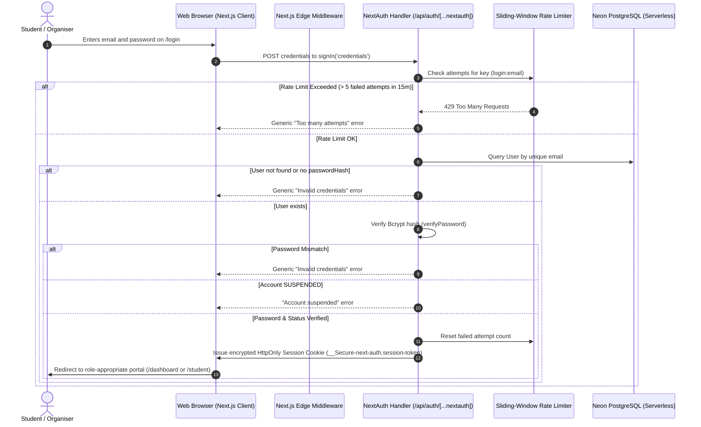

# GDG LabOps — Authentication & Secure Session Architecture

> **Document Version:** 1.0.0  
> **Auth Framework:** Auth.js / NextAuth.js 4.x (App Router)  
> **Session Strategy:** Encrypted JWT via Secure HttpOnly Cookies  
> **Password Encryption:** Bcrypt (12 Salt Rounds)  
> **Token Encryption:** SHA-256 for Single-Use Ephemeral Tokens  

---

## 1. Authentication Architectural Overview

GDG LabOps uses **Auth.js (NextAuth.js)** configured for the Next.js App Router. The platform strictly rejects unsafe authentication paradigms such as client-accessible JWTs stored in `localStorage` or session fixation risks.



---

## 2. Session Management Specification

### Cookie Configuration & Hardening
- **Cookie Name**: `__Secure-next-auth.session-token` (Production) / `next-auth.session-token` (Dev)
- **HttpOnly**: `true` (Inaccessible to JavaScript, completely preventing XSS-based token theft)
- **SameSite**: `Lax` (Prevents Cross-Site Request Forgery / CSRF while supporting top-level cross-site navigations)
- **Secure**: `true` in production (Transmitted strictly over TLS/HTTPS)
- **Session Max Age**: 30 days (`2,592,000` seconds)
- **Strategy**: JSON Web Token (`jwt`) signed using SHA-512 via `NEXTAUTH_SECRET`

### Token Payload Structure
The server-side session token carries verified minimal claims:
```json
{
  "id": "7786cd6c-2e35-456a-a06e-607012a226d1",
  "name": "Alex Rivera",
  "email": "alex.rivera@gdgcampus.dev",
  "role": "ORGANISER",
  "status": "ACTIVE",
  "avatar": "https://images.unsplash.com/photo-1534528741775-53994a69daeb",
  "iat": 1730810400,
  "exp": 1733402400
}
```

---

## 3. Cryptography & Password Security

### Password Hashing Standards
- **Algorithm**: Bcrypt with **12 salt rounds** (`bcrypt.hash(password, 12)`).
- **Execution**: Computationally resilient against offline GPU dictionary and brute-force attacks.
- **Timing Attacks**: Compared using `bcrypt.compare()` which executes in constant time to prevent side-channel timing analysis.

### Password Policy
The platform enforces a strict password policy validated on both client and server via Zod (`lib/validations/index.ts`):
- Minimum **8 characters**
- At least one **uppercase letter** (`A-Z`)
- At least one **lowercase letter** (`a-z`)
- At least one **digit** (`0-9`)
- At least one **special character** (`[^A-Za-z0-9]`)

---

## 4. User Registration Flow

- **Endpoint**: `POST /api/auth/register`
- **Fields**: `name`, `email`, `password`, `confirmPassword`

### Enforced Invariants:
1. **Zero-Trust Role Assignment**: The `role` field cannot be set by the client. Any attempt to supply `SUPER_ADMIN` or `ORGANISER` is rejected with `400 Bad Request`. Every public registration is assigned `Role.STUDENT`.
2. **Duplicate Prevention**: Rejects duplicate email addresses with `409 Conflict`.
3. **Data Sanitization**: Email is trimmed and converted to lowercase.
4. **Auto Chapter Enrolment**: Automatically adds the student as `OrganisationRole.MEMBER` to the primary community chapter.

---

## 5. Password Reset Workflow

1. **Request Reset**: User posts email to `POST /api/auth/forgot-password`.
2. **Account Enumeration Defense**: The endpoint **always** responds with a 200 OK and a generic confirmation message regardless of whether the email exists in the database.
3. **Token Generation**: Generates 64 random hexadecimal bytes (`crypto.randomBytes(32)`).
4. **Database Storage**: The raw token is **never stored**. Only a SHA-256 hash (`hashToken(rawToken)`) is stored in `password_reset_tokens` with a strict **1-hour expiration**.
5. **Execution**: The user opens `/reset-password?token=...` and posts to `POST /api/auth/reset-password`.
6. **Token Consumption**: The token is invalidated in a single database transaction upon updating `passwordHash`.

---

## 6. Account Lifecycle & Statuses

Users have an explicit `status` field (`UserStatus`):

| Status | Permitted Actions | Token Handling |
| :--- | :--- | :--- |
| **`ACTIVE`** | Normal authenticated operations within role permissions. | Standard JWT session token issued. |
| **`SUSPENDED`** | Completely barred from signing in and calling APIs. | Middleware immediately terminates requests with `403 Forbidden` and redirects to `/login?error=ACCOUNT_SUSPENDED`. |
| **`PENDING_VERIFICATION`** | Restricted from launching interactive cloud sandbox containers. | Prompted to verify email via link. |

---

## 7. Future Extensibility: Google OAuth

The Auth.js configuration in [`lib/auth/auth-options.ts`](file:///d:/projects/GDGLABOPS/lib/auth/auth-options.ts) includes dedicated integration hooks for Google OAuth:

```typescript
// Google OAuth Provider (Ready for future activation)
// GoogleProvider({
//   clientId: process.env.GOOGLE_CLIENT_ID!,
//   clientSecret: process.env.GOOGLE_CLIENT_SECRET!,
// }),
```
When Google credentials are provided, accounts can be linked using OAuth account linking without modifying the core user schema.
