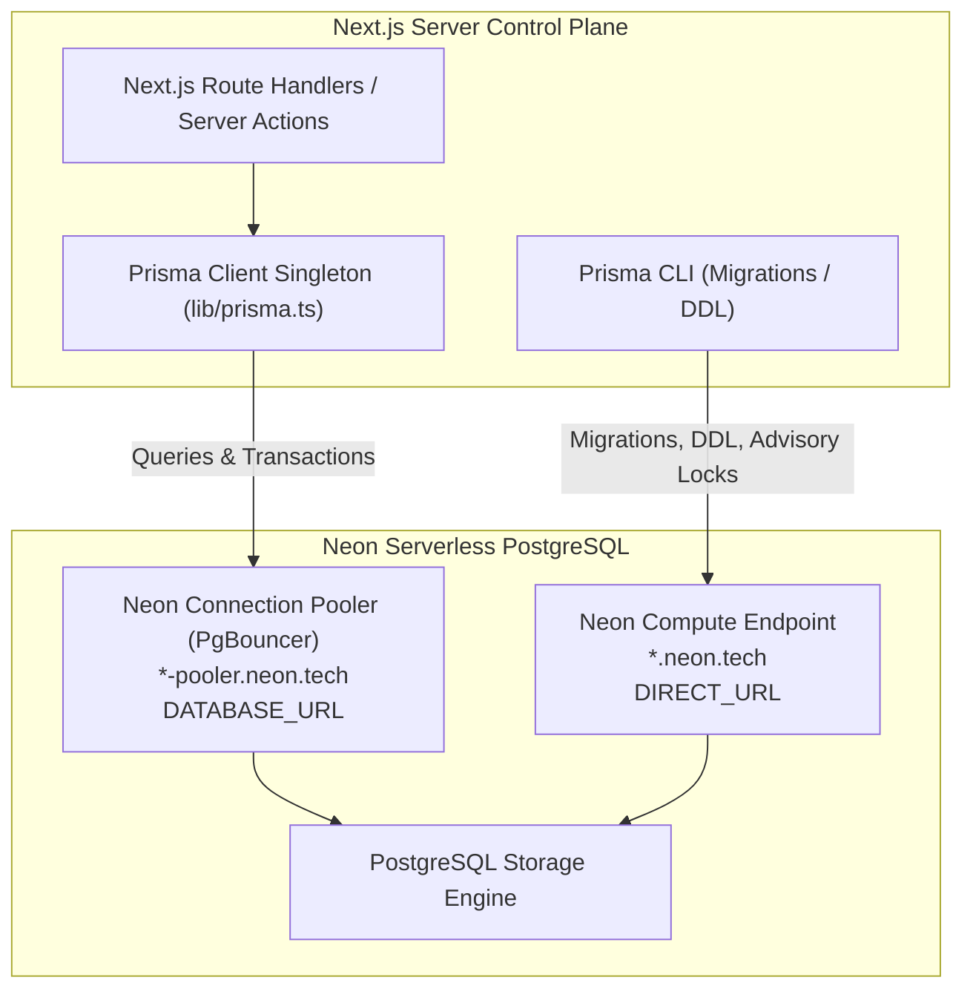
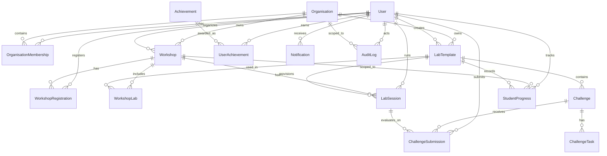

# GDG LabOps — Database Architecture & Neon PostgreSQL Schema

> **Document Version:** 1.0.0  
> **Database Provider:** Neon Serverless PostgreSQL  
> **ORM Layer:** Prisma ORM 5.x  
> **Driver Compatibility:** PgBouncer Connection Pooling + Direct Migration Engine  

---

## 1. Architectural Overview

GDG LabOps uses **Neon Serverless PostgreSQL** as its primary relational datastore. The database layer is designed to support high-concurrency workshop spikes, multi-tenant community isolation, role-based access control, and decoupled lab execution tracking.

### Connection Architecture

Neon provides two distinct connection modes, both configured through Prisma:

1. **Pooled Connection (`DATABASE_URL`)**:
   - Uses Neon's native PgBouncer connection pooling on port `5432` with connection flag `?pgbouncer=true`.
   - Used by the Next.js runtime (server routes, services, server actions) to maintain low latency and eliminate connection starvation during concurrent participant spikes.
2. **Direct Connection (`DIRECT_URL`)**:
   - Directly accesses the unpooled Neon compute node.
   - Required by Prisma CLI for running schema migrations (`prisma migrate dev`, `prisma migrate deploy`), which require advisory locks and prepared statement isolation that pooled connections do not support.

---

## 2. Entity Relationship Diagram

---

## 3. Enumerations

The database defines 13 strongly-typed PostgreSQL enums:

| Enum Name | Values | Purpose |
| :--- | :--- | :--- |
| `Role` | `SUPER_ADMIN`, `ORGANISER`, `STUDENT` | System-wide authorization tiers |
| `OrganisationRole` | `OWNER`, `ADMIN`, `MEMBER`, `MENTOR` | Multi-tenant chapter permission levels |
| `MembershipStatus` | `ACTIVE`, `INVITED`, `SUSPENDED` | Member lifecycle in an organisation |
| `WorkshopStatus` | `DRAFT`, `PUBLISHED`, `ONGOING`, `COMPLETED`, `CANCELLED` | Event lifecycle state machine |
| `RegistrationStatus`| `REGISTERED`, `WAITLISTED`, `CANCELLED` | Student enrollment status |
| `AttendanceStatus` | `ABSENT`, `ATTENDED`, `EXCUSED` | Live participation tracking |
| `Difficulty` | `BEGINNER`, `INTERMEDIATE`, `ADVANCED` | Content difficulty rating |
| `TemplateStatus` | `DRAFT`, `PUBLISHED`, `ARCHIVED` | Lab blueprint catalog status |
| `EvaluationType` | `COMMAND_EXIT_CODE`, `STDOUT_REGEX`, `FILE_CONTENT`, `HTTP_PROBE` | Automated challenge evaluation method |
| `ChallengeStatus` | `ACTIVE`, `DRAFT`, `ARCHIVED` | Challenge task accessibility |
| `SessionStatus` | `PENDING`, `PROVISIONING`, `RUNNING`, `COMPLETED`, `FAILED`, `TERMINATED`, `EXPIRED` | Docker execution sandbox state |
| `SubmissionStatus` | `PENDING`, `PASSED`, `FAILED`, `ERROR` | Automated grading result |
| `NotificationType` | `INFO`, `SUCCESS`, `WARNING`, `ERROR`, `ACHIEVEMENT` | User notification categorization |

---

## 4. Detailed Table Specifications

### 4.1. `users`
Core user entity supporting identity, global roles, and profile settings.

| Column | PostgreSQL Type | Nullable | Constraints & Defaults | Description |
| :--- | :--- | :--- | :--- | :--- |
| `id` | `UUID` | No | Primary Key, `gen_random_uuid()` | Unique user identifier |
| `name` | `VARCHAR(255)` | No | — | User full display name |
| `email` | `VARCHAR(255)` | No | `UNIQUE` | User login email address |
| `password_hash`| `TEXT` | Yes | — | Hashed password (omitted for OAuth) |
| `avatar` | `TEXT` | Yes | — | Public avatar image URL |
| `role` | `Role` | No | Default: `STUDENT` | Global platform authorization role |
| `created_at` | `TIMESTAMPTZ` | No | Default: `now()` | Timestamp of creation |
| `updated_at` | `TIMESTAMPTZ` | No | Automatically updated | Timestamp of last modification |

**Indexes & Constraints:**
- `users_email_key`: Unique index on `email`

---

### 4.2. `organisations`
Multi-tenant container representing individual developer chapters (e.g. GDG on Campus Silicon Valley).

| Column | PostgreSQL Type | Nullable | Constraints & Defaults | Description |
| :--- | :--- | :--- | :--- | :--- |
| `id` | `UUID` | No | Primary Key, `gen_random_uuid()` | Organisation identifier |
| `name` | `VARCHAR(255)` | No | — | Community name |
| `slug` | `VARCHAR(100)` | No | `UNIQUE` | URL-safe slug |
| `description` | `TEXT` | Yes | — | Organisation bio / mission statement |
| `logo` | `TEXT` | Yes | — | Brand logo asset URL |
| `created_at` | `TIMESTAMPTZ` | No | Default: `now()` | Creation timestamp |
| `updated_at` | `TIMESTAMPTZ` | No | Automatically updated | Last update timestamp |

**Indexes & Constraints:**
- `organisations_slug_key`: Unique index on `slug`

---

### 4.3. `organisation_memberships`
Junction table mapping users to organisations with scoped roles.

| Column | PostgreSQL Type | Nullable | Constraints & Defaults | Description |
| :--- | :--- | :--- | :--- | :--- |
| `id` | `UUID` | No | Primary Key, `gen_random_uuid()` | Membership identifier |
| `organisation_id`| `UUID` | No | Foreign Key (`organisations.id`) `ON DELETE CASCADE` | Associated organisation |
| `user_id` | `UUID` | No | Foreign Key (`users.id`) `ON DELETE CASCADE` | Associated user |
| `role` | `OrganisationRole` | No | Default: `MEMBER` | Chapter permission tier |
| `joined_at` | `TIMESTAMPTZ` | No | Default: `now()` | Join timestamp |
| `status` | `MembershipStatus` | No | Default: `ACTIVE` | Member status |

**Indexes & Constraints:**
- `unique_organisation_user`: Composite unique constraint on `(organisation_id, user_id)`
- `organisation_memberships_user_id_idx`: B-tree index on `user_id`
- `organisation_memberships_organisation_id_idx`: B-tree index on `organisation_id`

---

### 4.4. `workshops`
Events scheduled by organisers within an organisation.

| Column | PostgreSQL Type | Nullable | Constraints & Defaults | Description |
| :--- | :--- | :--- | :--- | :--- |
| `id` | `UUID` | No | Primary Key, `gen_random_uuid()` | Workshop identifier |
| `organisation_id`| `UUID` | No | Foreign Key (`organisations.id`) `ON DELETE CASCADE` | Owning organisation |
| `organiser_id` | `UUID` | No | Foreign Key (`users.id`) `ON DELETE RESTRICT` | Workshop creator/lead |
| `title` | `VARCHAR(255)` | No | — | Workshop title |
| `slug` | `VARCHAR(150)` | No | `UNIQUE` | URL-safe workshop slug |
| `description` | `TEXT` | No | — | Markdown workshop summary |
| `domain` | `VARCHAR(100)` | No | — | Technical track (e.g. Cloud, Security) |
| `banner_url` | `TEXT` | Yes | — | Promotional header image URL |
| `start_date` | `TIMESTAMPTZ` | No | — | Scheduled workshop start |
| `end_date` | `TIMESTAMPTZ` | No | — | Scheduled workshop conclusion |
| `duration` | `INTEGER` | No | In minutes | Planned duration |
| `registration_deadline`| `TIMESTAMPTZ` | No | — | Cutoff timestamp for registrations |
| `participant_limit` | `INTEGER` | No | Default: `50` | Maximum student capacity |
| `registration_code` | `VARCHAR(20)` | No | `UNIQUE` | Secret code for workshop entry |
| `status` | `WorkshopStatus` | No | Default: `DRAFT` | Current lifecycle state |
| `created_at` | `TIMESTAMPTZ` | No | Default: `now()` | Creation timestamp |
| `updated_at` | `TIMESTAMPTZ` | No | Automatically updated | Last update timestamp |

**Indexes & Constraints:**
- `workshops_slug_key`: Unique index on `slug`
- `workshops_registration_code_key`: Unique index on `registration_code`
- `workshops_registration_code_idx`: B-tree index on `registration_code`
- `workshops_status_idx`: B-tree index on `status`
- `workshops_organisation_id_idx`: B-tree index on `organisation_id`
- `workshops_organiser_id_idx`: B-tree index on `organiser_id`

---

### 4.5. `workshop_registrations`
Student enrollment records for workshops.

| Column | PostgreSQL Type | Nullable | Constraints & Defaults | Description |
| :--- | :--- | :--- | :--- | :--- |
| `id` | `UUID` | No | Primary Key, `gen_random_uuid()` | Registration identifier |
| `workshop_id` | `UUID` | No | Foreign Key (`workshops.id`) `ON DELETE CASCADE` | Target workshop |
| `student_id` | `UUID` | No | Foreign Key (`users.id`) `ON DELETE CASCADE` | Enrolled student |
| `registered_at` | `TIMESTAMPTZ` | No | Default: `now()` | Timestamp of enrollment |
| `status` | `RegistrationStatus`| No | Default: `REGISTERED` | Admission status |
| `attendance_status` | `AttendanceStatus` | No | Default: `ABSENT` | Physical or online attendance |

**Indexes & Constraints:**
- `unique_workshop_student_registration`: Composite unique constraint on `(workshop_id, student_id)`
- `workshop_registrations_workshop_id_idx`: B-tree index on `workshop_id`
- `workshop_registrations_student_id_idx`: B-tree index on `student_id`

---

### 4.6. `lab_templates`
Reusable lab blueprints defining Docker runtime environment specs and challenge curricula.

| Column | PostgreSQL Type | Nullable | Constraints & Defaults | Description |
| :--- | :--- | :--- | :--- | :--- |
| `id` | `UUID` | No | Primary Key, `gen_random_uuid()` | Template identifier |
| `organisation_id`| `UUID` | No | Foreign Key (`organisations.id`) `ON DELETE CASCADE` | Owning organisation |
| `created_by` | `UUID` | No | Foreign Key (`users.id`) `ON DELETE RESTRICT` | Author user ID |
| `name` | `VARCHAR(255)` | No | — | Human-readable title |
| `description` | `TEXT` | No | — | In-depth description |
| `domain` | `VARCHAR(100)` | No | — | Technical category |
| `difficulty` | `Difficulty` | No | Default: `INTERMEDIATE` | Target skill level |
| `estimated_duration` | `INTEGER` | No | In minutes | Estimated completion time |
| `environment_type` | `VARCHAR(50)` | No | Default: `'terminal'` | UI interface (`terminal`, `vscode`, `web-app`) |
| `learning_objectives`| `JSONB` | No | Array of strings | Structured objective list |
| `prerequisites` | `JSONB` | No | Array of strings | Required prior knowledge |
| `short_description` | `VARCHAR(300)` | Yes | — | 1-line summary |
| `cover_image_url` | `TEXT` | Yes | Valid URL | Visual template card cover |
| `tags` | `TEXT[]` | No | Default: `{}` | Searchable categorization tags |
| `required_tools` | `JSONB` | Yes | Array of `{ name, version }` | System tools specifications |
| `version` | `INTEGER` | No | Default: `1` | Curriculum version counter |
| `status` | `TemplateStatus` | No | Default: `DRAFT` | Publication status (`DRAFT`, `PUBLISHED`, `ARCHIVED`) |
| `created_at` | `TIMESTAMPTZ` | No | Default: `now()` | Creation timestamp |
| `updated_at` | `TIMESTAMPTZ` | No | Automatically updated | Last update timestamp |

**Indexes & Constraints:**
- `lab_templates_organisation_id_idx`: B-tree index on `organisation_id`
- `lab_templates_domain_idx`: B-tree index on `domain`
- `lab_templates_status_idx`: B-tree index on `status`

---

### 4.7. `workshop_labs`
Junction mapping reusable lab templates to workshops in an ordered curriculum with an immutable snapshot.

| Column | PostgreSQL Type | Nullable | Constraints & Defaults | Description |
| :--- | :--- | :--- | :--- | :--- |
| `id` | `UUID` | No | Primary Key, `gen_random_uuid()` | Junction identifier |
| `workshop_id` | `UUID` | No | Foreign Key (`workshops.id`) `ON DELETE CASCADE` | Parent workshop |
| `lab_template_id`| `UUID` | No | Foreign Key (`lab_templates.id`) `ON DELETE RESTRICT` | Referenced lab template |
| `display_order` | `INTEGER` | No | Default: `1` | Sequence in workshop lab track |
| `is_required` | `BOOLEAN` | No | Default: `true` | Required for workshop completion |
| `available_from` | `TIMESTAMPTZ` | Yes | — | Optional availability start window |
| `available_until` | `TIMESTAMPTZ` | Yes | — | Optional availability end window |
| `lab_snapshot` | `JSONB` | Yes | Snapshot object | Immutable frozen snapshot of template & challenges |

**Indexes & Constraints:**
- `unique_workshop_lab_template`: Composite unique constraint on `(workshop_id, lab_template_id)`
- `workshop_labs_workshop_id_idx`: B-tree index on `workshop_id`
- `workshop_labs_lab_template_id_idx`: B-tree index on `lab_template_id`

---

### 4.8. `challenges`
Milestones and practical exercises inside a lab template evaluated across 5 pedagogical formats.

| Column | PostgreSQL Type | Nullable | Constraints & Defaults | Description |
| :--- | :--- | :--- | :--- | :--- |
| `id` | `UUID` | No | Primary Key, `gen_random_uuid()` | Challenge identifier |
| `lab_template_id`| `UUID` | No | Foreign Key (`lab_templates.id`) `ON DELETE CASCADE` | Parent lab template |
| `title` | `VARCHAR(255)` | No | — | Challenge title |
| `description` | `TEXT` | No | — | Problem context and scenario |
| `instructions` | `TEXT` | No | — | Step-by-step instructions (Markdown) |
| `challenge_type` | `ChallengeType` | No | Default: `MULTIPLE_CHOICE` | `MULTIPLE_CHOICE`, `SHORT_ANSWER`, `CODE_KNOWLEDGE`, `GUIDED_TASK`, `RESEARCH_REFLECTION` |
| `difficulty` | `Difficulty` | No | Default: `INTERMEDIATE` | Task complexity |
| `points` | `INTEGER` | No | Default: `100` | Points awarded upon passing |
| `time_limit` | `INTEGER` | Yes | In minutes | Optional countdown timer |
| `display_order` | `INTEGER` | No | Default: `1` | Sequence within template |
| `hints` | `JSONB` | Yes | Array of `{ id, orderIndex, content, penaltyPercent }` | Sequential hint ladder |
| `reference_material`| `TEXT` | Yes | Markdown / Docs | Architectural reference documentation |
| `solution_data` | `JSONB` | Yes | Server-side only | Verification rules, hidden keys, correct options |
| `explanation` | `TEXT` | Yes | Markdown | Post-completion educational breakdown |
| `evaluation_type`| `EvaluationType`| No | Default: `COMMAND_EXIT_CODE` | Verification mechanism |
| `status` | `ChallengeStatus` | No | Default: `ACTIVE` | Availability status |
| `created_at` | `TIMESTAMPTZ` | No | Default: `now()` | Creation timestamp |
| `updated_at` | `TIMESTAMPTZ` | No | Automatically updated | Last update timestamp |

**Indexes & Constraints:**
- `challenges_lab_template_id_idx`: B-tree index on `lab_template_id`

---

### 4.9. `challenge_tasks`
Discrete automated assertions within a challenge. Designed specifically without arbitrary shell scripts to prevent code injection vulnerabilities.

| Column | PostgreSQL Type | Nullable | Constraints & Defaults | Description |
| :--- | :--- | :--- | :--- | :--- |
| `id` | `UUID` | No | Primary Key, `gen_random_uuid()` | Task identifier |
| `challenge_id` | `UUID` | No | Foreign Key (`challenges.id`) `ON DELETE CASCADE` | Parent challenge |
| `title` | `VARCHAR(255)` | No | — | Task title |
| `description` | `TEXT` | No | — | Task validation goal |
| `task_type` | `VARCHAR(50)` | No | — | Assertion kind (e.g. `FILE_CHECK`) |
| `evaluation_config` | `JSONB` | No | Predefined Assertion Schema | Structured rule object |
| `points` | `INTEGER` | No | Default: `50` | Individual task points |
| `display_order` | `INTEGER` | No | Default: `1` | Sub-task sequence |

**Indexes & Constraints:**
- `challenge_tasks_challenge_id_idx`: B-tree index on `challenge_id`

---

### 4.10. `lab_sessions`
Active sandbox execution environments allocated to students on remote execution servers.

| Column | PostgreSQL Type | Nullable | Constraints & Defaults | Description |
| :--- | :--- | :--- | :--- | :--- |
| `id` | `UUID` | No | Primary Key, `gen_random_uuid()` | Session identifier |
| `student_id` | `UUID` | No | Foreign Key (`users.id`) `ON DELETE CASCADE` | Operating student |
| `workshop_id` | `UUID` | No | Foreign Key (`workshops.id`) `ON DELETE CASCADE` | Context workshop |
| `lab_template_id`| `UUID` | No | Foreign Key (`lab_templates.id`) `ON DELETE RESTRICT` | Environment template |
| `status` | `SessionStatus` | No | Default: `PENDING` | Lifecycle state (`PENDING`, `PROVISIONING`, `RUNNING`, `STOPPING`, `STOPPED`, `COMPLETED`, `FAILED`, `TERMINATED`, `EXPIRED`) |
| `container_reference`| `TEXT` | Yes | **Server-side only** | Internal Docker container ID / hash |
| `access_url` | `TEXT` | Yes | Ephemeral | WebSocket / web proxy URL |
| `runner_url` | `TEXT` | Yes | — | Internal execution host URL |
| `runner_id` | `TEXT` | Yes | — | Identifier of executing runner node |
| `environment_profile`| `TEXT` | Yes | Default: `ubuntu-fundamentals` | Approved image profile tag |
| `session_token` | `TEXT` | Yes | Unique | Cryptographic session authorization token |
| `connection_ticket` | `TEXT` | Yes | Ephemeral | Single-use HMAC-signed WebSocket ticket |
| `ticket_expires_at` | `TIMESTAMPTZ` | Yes | — | Expiration time for ticket redemption |
| `last_activity_at` | `TIMESTAMPTZ` | Yes | — | Last received terminal command / heartbeat |
| `started_at` | `TIMESTAMPTZ` | Yes | — | Timestamp container became live |
| `stopped_at` | `TIMESTAMPTZ` | Yes | — | Timestamp container stopped |
| `expires_at` | `TIMESTAMPTZ` | Yes | — | TTL expiration deadline |
| `terminated_at` | `TIMESTAMPTZ` | Yes | — | Teardown timestamp |
| `termination_reason` | `TEXT` | Yes | — | Reason (`STUDENT_STOPPED`, `TIMEOUT_EXPIRED`, `ADMIN_TERMINATED`) |
| `failure_reason` | `TEXT` | Yes | — | Diagnostic error message if failed |
| `resource_limits` | `JSONB` | Yes | — | Effective cgroups limits (memory, nanoCPUs, pids) |
| `created_at` | `TIMESTAMPTZ` | No | Default: `now()` | Session creation timestamp |

**Security Note:** `container_reference` is strictly stripped from all student-facing API responses to avoid leaking underlying cloud infrastructure identifiers.

**Indexes & Constraints:**
- `lab_sessions_session_token_key`: Unique constraint on `session_token`
- `lab_sessions_student_id_idx`: B-tree index on `student_id`
- `lab_sessions_workshop_id_idx`: B-tree index on `workshop_id`
- `lab_sessions_status_idx`: B-tree index on `status`

---

### 4.11. `session_events`
Audit log of container lifecycle transitions and terminal connection events.

| Column | PostgreSQL Type | Nullable | Constraints & Defaults | Description |
| :--- | :--- | :--- | :--- | :--- |
| `id` | `UUID` | No | Primary Key, `gen_random_uuid()` | Event identifier |
| `session_id` | `UUID` | No | Foreign Key (`lab_sessions.id`) `ON DELETE CASCADE` | Associated lab session |
| `event_type` | `VARCHAR(100)` | No | — | Event name (`PROVISION_REQUESTED`, `CONTAINER_STARTED`, `WS_CONNECTED`, `HEARTBEAT`, `CONTAINER_STOPPED`, `CONTAINER_DESTROYED`, `ERROR`) |
| `message` | `TEXT` | Yes | — | Human-readable log summary |
| `metadata` | `JSONB` | Yes | — | Event diagnostic attributes |
| `created_at` | `TIMESTAMPTZ` | No | Default: `now()` | Event recorded timestamp |

---

### 4.12. `resource_usage_metrics`
Telemetry snapshots recording container resource utilization.

| Column | PostgreSQL Type | Nullable | Constraints & Defaults | Description |
| :--- | :--- | :--- | :--- | :--- |
| `id` | `UUID` | No | Primary Key, `gen_random_uuid()` | Metric identifier |
| `session_id` | `UUID` | No | Foreign Key (`lab_sessions.id`) `ON DELETE CASCADE` | Target lab session |
| `cpu_percent` | `DOUBLE PRECISION`| No | Default: `0` | CPU utilization percentage |
| `memory_usage_mb`| `DOUBLE PRECISION`| No | Default: `0` | Resident set size (RSS) memory in MB |
| `pids_count` | `INTEGER` | No | Default: `0` | Active process count in container |
| `recorded_at` | `TIMESTAMPTZ` | No | Default: `now()` | Timestamp of metric snapshot |

---

### 4.11. `challenge_submissions`
Automated assessment records generated when a student triggers task evaluation.

| Column | PostgreSQL Type | Nullable | Constraints & Defaults | Description |
| :--- | :--- | :--- | :--- | :--- |
| `id` | `UUID` | No | Primary Key, `gen_random_uuid()` | Submission identifier |
| `student_id` | `UUID` | No | Foreign Key (`users.id`) `ON DELETE CASCADE` | Submitting student |
| `challenge_id` | `UUID` | No | Foreign Key (`challenges.id`) `ON DELETE CASCADE` | Evaluated challenge |
| `lab_session_id` | `UUID` | No | Foreign Key (`lab_sessions.id`) `ON DELETE CASCADE` | Execution container |
| `submission_data`| `JSONB` | No | — | Payload or test assertion outputs |
| `score` | `INTEGER` | No | Default: `0` | Points awarded |
| `status` | `SubmissionStatus` | No | Default: `PENDING` | Evaluation outcome |
| `submitted_at` | `TIMESTAMPTZ` | No | Default: `now()` | Submission timestamp |
| `evaluated_at` | `TIMESTAMPTZ` | Yes | — | Timestamp evaluation concluded |

**Indexes & Constraints:**
- `challenge_submissions_student_id_idx`: B-tree index on `student_id`
- `challenge_submissions_challenge_id_idx`: B-tree index on `challenge_id`
- `challenge_submissions_lab_session_id_idx`: B-tree index on `lab_session_id`

---

### 4.12. `student_progress`
Aggregated progress rollups per student across workshops and lab templates.

| Column | PostgreSQL Type | Nullable | Constraints & Defaults | Description |
| :--- | :--- | :--- | :--- | :--- |
| `id` | `UUID` | No | Primary Key, `gen_random_uuid()` | Record identifier |
| `student_id` | `UUID` | No | Foreign Key (`users.id`) `ON DELETE CASCADE` | Student user ID |
| `workshop_id` | `UUID` | No | Foreign Key (`workshops.id`) `ON DELETE CASCADE` | Workshop scope |
| `lab_template_id`| `UUID` | No | Foreign Key (`lab_templates.id`) `ON DELETE RESTRICT` | Lab template scope |
| `completed_challenges`| `INTEGER` | No | Default: `0` | Count of challenges completed |
| `total_challenges`| `INTEGER` | No | Default: `0` | Total challenges in template |
| `total_points` | `INTEGER` | No | Default: `0` | Accumulated points |
| `completion_percentage`| `DOUBLE PRECISION`| No | Default: `0.0` | Progress (0.00 to 100.00) |
| `completed_at` | `TIMESTAMPTZ` | Yes | — | Timestamp of full lab completion |
| `updated_at` | `TIMESTAMPTZ` | No | Automatically updated | Last progress update |

**Indexes & Constraints:**
- `unique_student_workshop_lab_progress`: Composite unique constraint on `(student_id, workshop_id, lab_template_id)`
- `student_progress_student_id_idx`: B-tree index on `student_id`
- `student_progress_workshop_id_idx`: B-tree index on `workshop_id`

---

### 4.13. `achievements`
Catalog of unlockable badges and milestones.

| Column | PostgreSQL Type | Nullable | Constraints & Defaults | Description |
| :--- | :--- | :--- | :--- | :--- |
| `id` | `UUID` | No | Primary Key, `gen_random_uuid()` | Achievement identifier |
| `name` | `VARCHAR(255)` | No | — | Badge name |
| `description` | `TEXT` | No | — | Unlock requirement description |
| `icon` | `VARCHAR(100)` | No | — | Lucide icon identifier |
| `category` | `VARCHAR(50)` | No | — | Badge category (e.g. `SPEED`, `MASTERY`)|
| `points` | `INTEGER` | No | Default: `50` | Bonus reputation points |

---

### 4.14. `user_achievements`
Junction table tracking unlocked achievements per user.

| Column | PostgreSQL Type | Nullable | Constraints & Defaults | Description |
| :--- | :--- | :--- | :--- | :--- |
| `id` | `UUID` | No | Primary Key, `gen_random_uuid()` | Award identifier |
| `user_id` | `UUID` | No | Foreign Key (`users.id`) `ON DELETE CASCADE` | Student recipient |
| `achievement_id` | `UUID` | No | Foreign Key (`achievements.id`) `ON DELETE CASCADE` | Unlocked achievement |
| `awarded_at` | `TIMESTAMPTZ` | No | Default: `now()` | Unlock timestamp |

**Indexes & Constraints:**
- `unique_user_achievement`: Composite unique constraint on `(user_id, achievement_id)`
- `user_achievements_user_id_idx`: B-tree index on `user_id`

---

### 4.15. `notifications`
Real-time user notification inbox.

| Column | PostgreSQL Type | Nullable | Constraints & Defaults | Description |
| :--- | :--- | :--- | :--- | :--- |
| `id` | `UUID` | No | Primary Key, `gen_random_uuid()` | Notification identifier |
| `user_id` | `UUID` | No | Foreign Key (`users.id`) `ON DELETE CASCADE` | Recipient user |
| `title` | `VARCHAR(255)` | No | — | Alert headline |
| `message` | `TEXT` | No | — | Body text / details |
| `type` | `NotificationType`| No | Default: `INFO` | Alert category |
| `is_read` | `BOOLEAN` | No | Default: `false` | Read status |
| `created_at` | `TIMESTAMPTZ` | No | Default: `now()` | Delivery timestamp |

**Indexes & Constraints:**
- `notifications_user_id_is_read_idx`: Composite index on `(user_id, is_read)` for low-latency unread count queries.

---

### 4.16. `audit_logs`
Immutable compliance and operational activity ledger.

| Column | PostgreSQL Type | Nullable | Constraints & Defaults | Description |
| :--- | :--- | :--- | :--- | :--- |
| `id` | `UUID` | No | Primary Key, `gen_random_uuid()` | Audit log identifier |
| `user_id` | `UUID` | Yes | Foreign Key (`users.id`) `ON DELETE SET NULL` | Performing user |
| `organisation_id`| `UUID` | Yes | Foreign Key (`organisations.id`) `ON DELETE SET NULL` | Associated organisation |
| `action` | `VARCHAR(100)` | No | — | Action name (e.g. `WORKSHOP_PUBLISHED`)|
| `resource_type` | `VARCHAR(50)` | No | — | Entity type (`Workshop`, `Session`) |
| `resource_id` | `VARCHAR(100)` | Yes | — | Subject entity ID |
| `metadata` | `JSONB` | Yes | Sanitized Payload | Event details (no passwords/tokens) |
| `created_at` | `TIMESTAMPTZ` | No | Default: `now()` | Timestamp of event |

**Indexes & Constraints:**
- `audit_logs_user_id_idx`: B-tree index on `user_id`
- `audit_logs_organisation_id_idx`: B-tree index on `organisation_id`
- `audit_logs_resource_type_idx`: B-tree index on `resource_type`

---

## 5. Foreign Key Integrity & Cascade Strategy

To maintain referential integrity without orphaned data or unintended cascading deletions:

| Relation | Foreign Key | Cascade Policy | Justification |
| :--- | :--- | :--- | :--- |
| Organisation ➔ Membership | `organisation_id` | `CASCADE` | Memberships cannot exist without an organisation |
| User ➔ Membership | `user_id` | `CASCADE` | Deleting a user cleans up memberships |
| User ➔ Workshop (Organiser)| `organiser_id` | `RESTRICT` | An organiser cannot be deleted if active workshops depend on them |
| Organisation ➔ Workshop | `organisation_id` | `CASCADE` | Deleting a chapter removes associated workshops |
| Workshop ➔ Registration | `workshop_id` | `CASCADE` | Registrations belong strictly to the workshop |
| Workshop ➔ WorkshopLab | `workshop_id` | `CASCADE` | Junction table entries are tied to the workshop lifecycle |
| LabTemplate ➔ WorkshopLab | `lab_template_id` | `RESTRICT` | Reusable lab templates in active use cannot be deleted |
| LabTemplate ➔ Challenge | `lab_template_id` | `CASCADE` | Challenges are embedded components of their template |
| User / Organisation ➔ AuditLog | `user_id` / `organisation_id` | `SET NULL` | Audit logs are permanent compliance records; deleting an entity preserves the log |

---

## 6. Security Guarantees in Schema Design

1. **Strictly Non-Executable Rule Assertions**: Challenge tasks are evaluated using strict JSON assertion schemas (`ruleType: FILE_EXISTS`, `PORT_LISTENING`, `PROCESS_STATUS`) rather than raw shell scripts stored in the database.
2. **Infrastructure Shielding**: The `lab_sessions.container_reference` field storing the internal Docker container hash is never transmitted in API responses to clients.
3. **Password Security**: Passwords are stored exclusively as bcrypt hashes in `password_hash`, never in plaintext, and are completely excluded from API serialization.
4. **No Direct Browser Access**: Neon connection credentials reside exclusively in server-side environment variables and are never bundled into client-side JavaScript.
