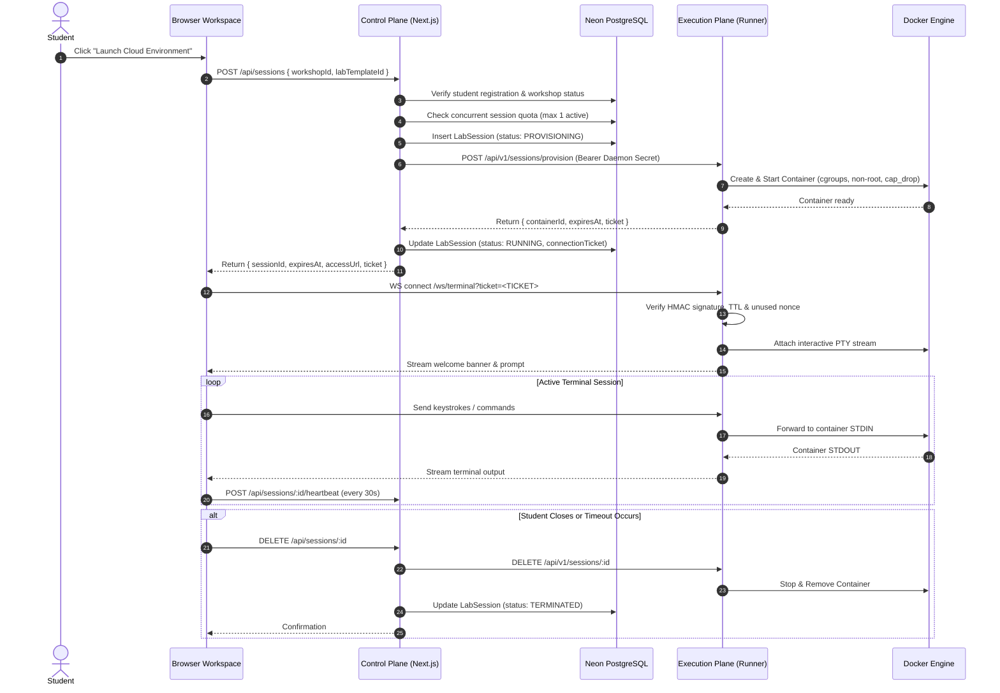

# GDG LabOps – Cloud Lab Execution Engine Architecture

## 1. Executive Summary

GDG LabOps provides remote, cloud-hosted Linux lab environments directly inside web browsers. This decouples hands-on technical workshops from student device configurations, operating systems, and local dependencies. Students on Windows, macOS, Linux, Chromebooks, or mobile tablets can complete hands-on terminal exercises without installing Docker, virtual machines, compilers, or platform runtimes.

The system is strictly partitioned into two independent operational planes:
1. **Control Plane**: Serverless-ready Next.js application handling authentication, role-based access control, workshop registration verification, session quotas, lifecycle state machines, audit logs, and single-use connection ticket issuance.
2. **Execution Plane**: Dedicated container execution service (`lab-runner/`) running on a secure Linux VM host. It interacts with the local Docker Engine via UNIX socket, enforces strict non-root isolation and cgroup resource limits, and hosts an authenticated WebSocket terminal streaming gateway.

```
+-------------------------------------------------------------------------+
|                               Browser                                   |
|   - Student Workspace UI (Next.js)                                      |
|   - Interactive Terminal Emulator (xterm.js / PTY WebSocket Stream)     |
+--------------------+--------------------------------+--------------------+
                     | HTTP API                       | WebSocket Stream
                     | (JWT / Auth.js)                | (Ticket Auth)
                     v                                v
+--------------------+-------------------+   +----------------------------+
|         CONTROL PLANE (Next.js)         |   |   EXECUTION PLANE (Runner) |
|   - Auth & RBAC Enforcement            |   |   - Node.js Service        |
|   - Workshop Registration Check        |   |   - WebSocket Gateway      |
|   - Concurrency Quotas (1/student)     |   |   - Crypto Ticket Verifier |
|   - Session Ticket Minting (HMAC)      |   |   - Auto Session Reaper    |
|   - State Transitions (Prisma)         |   |   - Docker Client Adapter  |
+--------------------+-------------------+   +-------------+--------------+
                     |                                     | UNIX Socket
                     v                                     v
+--------------------+-------------------+   +----------------------------+
|        NEON POSTGRESQL DATABASE        |   |    DOCKER ENGINE / CGROUPS |
|   - Users, Registrations, Workshops    |   |   - Approved Image Registry|
|   - LabTemplates, Challenges           |   |   - Non-Root UID 1000      |
|   - LabSessions, SessionEvents,        |   |   - CapDrop: ALL           |
|     ResourceUsageMetrics               |   |   - Ephemeral tmpfs Mounts |
+----------------------------------------+   +----------------------------+
```

---

## 2. Security Boundaries & Architectural Invariants

To guarantee platform resilience and protect host infrastructure:
1. **Zero Docker Daemon Exposure**: The Docker daemon UNIX socket (`/var/run/docker.sock`) is never exposed over TCP (ports 2375 or 2376). Only the local runner process on the execution host communicates with the socket.
2. **No Docker Inside Vercel**: Next.js serverless functions never interact with Docker directly. All provisioning and container lifecycle commands are routed through an authenticated internal REST API (`RunnerClientService`).
3. **Approved Image Registry Only**: Neither students nor organisers can supply arbitrary Docker image names, Dockerfiles, or container launch flags. Containers are instantiated strictly from the immutable `APPROVED_IMAGE_REGISTRY`.
4. **Shielded Container References**: Internal Docker container IDs (e.g. `sim_c_4f8a9e...` or 64-character SHA hashes) are stripped from all student-facing API responses.
5. **Single-Use Cryptographic Tickets**: WebSocket terminal sessions authenticate via HMAC-SHA256 connection tickets containing unique nonces, a 5-minute time-to-live, and anti-replay protection.

---

## 3. End-to-End Session Lifecycle Sequence


