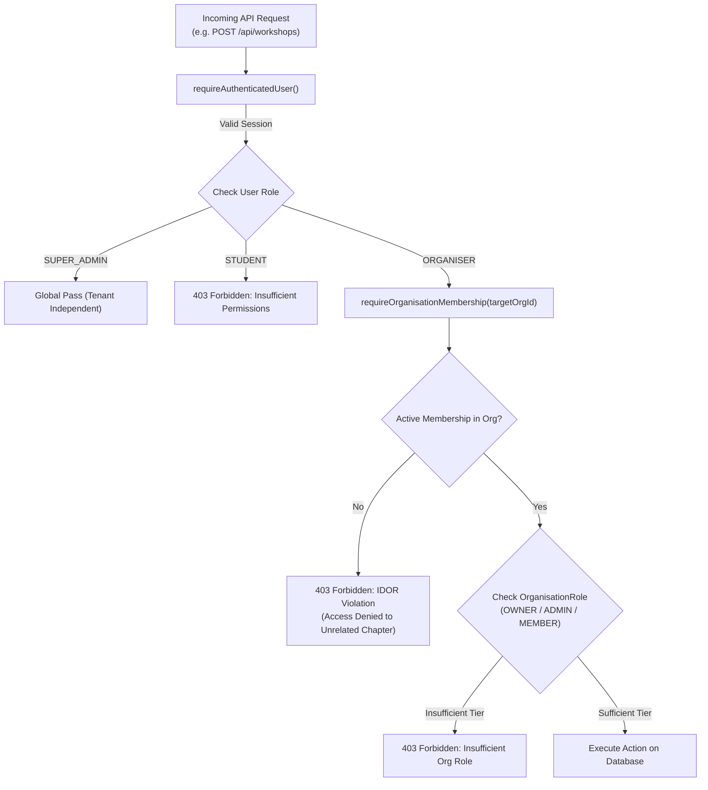

# GDG LabOps — Role-Based Access Control (RBAC) & Multi-Tenancy

> **Document Version:** 1.0.0  
> **Tenancy Architecture:** Multi-Tenant Chapters Scoped via `OrganisationMembership`  
> **Security Baseline:** Principle of Least Privilege (PoLP)  
> **Defenses:** Zero-Trust Server Verification & IDOR Elimination  

---

## 1. Role Hierarchy & Permission Matrix

GDG LabOps enforces three discrete platform roles (`Role`):

| Capability / Resource | STUDENT | ORGANISER | SUPER_ADMIN | Enforcing Helper |
| :--- | :---: | :---: | :---: | :--- |
| **Browse Published Workshops** | ✅ | ✅ | ✅ | `requireAuthenticatedUser()` |
| **Register for Workshops (Code/Direct)** | ✅ | ✅ | ✅ | `requireAuthenticatedUser()` |
| **Launch Ephemeral Sandbox Lab Sessions** | ✅ | ✅ | ✅ | `requireAuthenticatedUser()` |
| **Submit Challenge Evaluations** | ✅ | ✅ | ✅ | `requireAuthenticatedUser()` |
| **View Personal Progress & Badges** | ✅ | ✅ | ✅ | `requireAuthenticatedUser()` |
| **Edit Profile Display Name & Avatar** | ✅ | ✅ | ✅ | `requireAuthenticatedUser()` |
| **Change Account Password** | ✅ | ✅ | ✅ | `requireAuthenticatedUser()` |
| **Create Workshops (Own Chapter)** | ❌ | ✅ | ✅ | `requireOrganiser()` + `requireOrganisationMembership()` |
| **Publish / Cancel Workshops** | ❌ | ✅ | ✅ | `requireWorkshopOwnership()` |
| **Create Reusable Lab Templates** | ❌ | ✅ | ✅ | `requireOrganiser()` |
| **Create Challenges & Validation Tasks** | ❌ | ✅ | ✅ | `requireOrganiser()` |
| **Live Student Workshop Telemetry** | ❌ | ✅ | ✅ | `requireWorkshopOwnership()` |
| **Manage Chapter Team Members** | ❌ | ✅ (Admin/Owner) | ✅ | `requireOrganisationMembership(orgId, ['OWNER', 'ADMIN'])` |
| **Create New Chapters / Organisations** | ❌ | ❌ | ✅ | `requireSuperAdmin()` |
| **Suspend / Reactivate User Accounts** | ❌ | ❌ | ✅ | `requireSuperAdmin()` |
| **Assign or Revoke Super Admin Privileges** | ❌ | ❌ | ✅ | `requireSuperAdmin()` |
| **View Global Audit Logs** | ❌ | ❌ | ✅ | `requireSuperAdmin()` |

---

## 2. Multi-Tenancy & Chapter Authorization

To prevent cross-community data leakage and Insecure Direct Object Reference (IDOR) vulnerabilities, the platform decouples global authentication from organisation-level authorization.

### Organisation Roles (`OrganisationRole`)
Within a specific chapter, an organiser holds one of four roles:
1. **`OWNER`**: Creator or chapter lead; full administrative governance over chapter workshops and members.
2. **`ADMIN`**: Co-organisers with permission to create workshops, add lab templates, and invite instructors.
3. **`MEMBER`**: Default membership for attendees and students; read-only access to chapter materials.
4. **`MENTOR`**: Teaching assistants and mentors who can monitor active lab sessions but cannot publish/cancel events.

---

## 3. Server-Side Authorization Helpers

Located in [`lib/auth/rbac.ts`](file:///d:/projects/GDGLABOPS/lib/auth/rbac.ts):

### `requireAuthenticatedUser()`
- Validates the active NextAuth session.
- Verifies that `user.status !== 'SUSPENDED'`.
- Returns the authenticated user record including active memberships.

### `requireSuperAdmin()`
- Enforces `user.role === Role.SUPER_ADMIN`.
- Throws `ForbiddenError` (403) for any other role.

### `requireOrganiser()`
- Enforces `user.role === Role.ORGANISER || user.role === Role.SUPER_ADMIN`.
- Throws `ForbiddenError` (403) for students.

### `requireOrganisationMembership(organisationId, allowedRoles?)`
- Prevents IDOR by verifying that the user has an active membership matching `organisationId`.
- Super Admins bypass individual membership checks.
- If `allowedRoles` (e.g. `['OWNER', 'ADMIN']`) are supplied, verifies the member's rank.

### `requireWorkshopOwnership(workshopId)`
- Verifies that the workshop exists.
- Permits execution if:
  1. The user is a `SUPER_ADMIN`.
  2. The user is the original workshop creator (`workshop.organiserId === user.id`).
  3. The user holds `OWNER` or `ADMIN` status in the workshop's owning organisation.

---

## 4. Route Protection Strategy

### Next.js Edge Middleware ([`middleware.ts`](file:///d:/projects/GDGLABOPS/middleware.ts))
Acts as the first line of defense before requests reach Node.js runtime code:
- `/admin/*` ➔ Restricted to `SUPER_ADMIN`.
- `/dashboard/*` ➔ Restricted to `ORGANISER` and `SUPER_ADMIN`.
- `/student/*` ➔ Restricted to authenticated sessions.
- Automatically redirects unauthenticated traffic to `/login?callbackUrl=...`.

### Defense in Depth
Middleware routing guards are **never treated as the sole security boundary**. Every backend Route Handler under `/api/` independently invokes the RBAC helpers to verify identity and ownership at the data layer.
